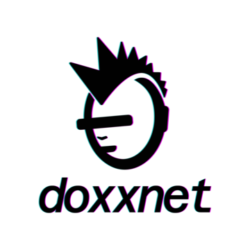

<picture>
  <source media="(prefers-color-scheme: dark)" srcset="assets/logo-light.png">
  <source media="(prefers-color-scheme: light)" srcset="assets/logo-dark.png">
  
</picture>

# doxx-skills

AI agent skills for setting up and managing [doxx.net](https://doxx.net) private networks through natural language.

Skills call the doxx.net API with `curl`. No Python, no servers, no daemons.

## Requirements

- A doxx.net account and an auth token: create both in the portal at [app.doxx.net](https://app.doxx.net)
- `curl` 7.55 or later (the skills pass it the token on stdin, which keeps the token out of the command line)
- `jq` 1.6 or later: used to show only the fields you need from an answer (so secrets such as tunnel tokens stay out of the conversation) and by the bundled Code Mode scripts. Without `jq`, skills make only single calls whose answers hold no secrets, and ask you to install it for the rest.

## Your token

doxx.net is anonymous by design: your auth token **is** your identity. Give the skills a token in one of these ways (the first one found wins):

1. `DOXX_TOKEN` environment variable (recommended):

   ```bash
   read -rs DOXX_TOKEN && export DOXX_TOKEN
   ```

   Paste the token at the silent prompt and press Enter. `read -rs` keeps the token off the screen and out of your shell history, which a plain `export DOXX_TOKEN=...` line would not.

2. A token file, mode 0600 (paste the token at the silent prompt, then press Enter):

   ```bash
   mkdir -p ~/.config/doxx && (umask 077 && read -rs t && printf %s "$t" > ~/.config/doxx/token)
   ```

3. Legacy names from earlier versions, still read: the `DOXXNET_TOKEN` variable and the `~/.config/doxxnet/token` file.

Skills pipe the token into `curl` on stdin (`--data-urlencode "token@-"`, or a curl config read with `-K -` when a call also carries a `tunnel_token` or another secret), so the shell expands it on your machine: it is not in the curl command line, not in the process list, and never in the messages sent to the AI provider. A `tunnel_token` travels the same way. To keep the token across sessions, save it in the token file (option 2) rather than writing it into your shell profile. For an agent, a dedicated `net-admin` token with a short expiry is the safest choice.

## Getting Started

### Claude Code

**CLI:**

```bash
claude /plugin marketplace add doxxcorp/doxx-skills
claude /plugin install doxxnet
```

**VS Code / Cursor:**

1. Open the plugin manager with `/plugins`
2. Switch to the **Marketplaces** tab and click **Add**: enter `doxxcorp/doxx-skills`
3. Switch to the **Plugins** tab and search for "doxx": **doxxnet** will appear
4. Click **Install** and choose your scope

The plugin installs all 14 skills (see [Skills](#skills)), so when `doxxnet` hands a request to a specialist skill such as `manage-vps`, that skill is there. Use any skill as a slash command:

```
/doxxnet:network-wizard
```

Set your token before you start Claude Code (see [Your token](#your-token)). If no token is found, the skill asks you to create one in the portal and save it yourself in your terminal. Pasting a token into the chat is the last resort: it then stays in the conversation context for the rest of the session and is sent to the AI provider with every later message. If you do paste one, use a short expiry and revoke it when the session ends.

### OpenClaw

```bash
openclaw skills install @doxxcorp/doxxnet
```

Or from a local clone:

```bash
openclaw skills install ./openclaw/skills/doxxnet
```

OpenClaw loads the skills when `DOXX_TOKEN` is set (or given as the skill's `apiKey` in the OpenClaw config). See [Your token](#your-token) and [openclaw/README.md](openclaw/README.md) for full setup.

### Codex

Run Codex from a skill directory: it auto-loads `AGENTS.md` as its instructions:

```bash
read -rs DOXX_TOKEN && export DOXX_TOKEN
cd codex/skills/doxxnet
codex
```

A token in `~/.config/doxx/token` works too (see [Your token](#your-token)).

Or pass a request directly with `codex exec`:

```bash
codex exec "Show me my tunnels and bandwidth usage"
```

See [codex/README.md](codex/README.md) for full setup.

### Other Agents

Any AI agent with shell access can use the API reference directly:

- **[api/reference.md](api/reference.md)**: Condensed doxx.net API reference optimized for agent consumption

Point your agent at the reference file and provide your doxx.net auth token at runtime. The live API also describes itself: `curl -s https://config.doxx.net/` returns the current manifest.

### doxx MCP tools

The skills use `curl` by default. If your agent session has a doxx MCP server configured, the skills use its tools automatically (the tool names match the API endpoint names, and the server adds the token). Nothing else changes.

## What's Inside

Two entry points cover everything, available across all three platforms:

| Command | What it does |
|---------|-------------|
| **doxxnet** | Manage anything: tunnels, firewall, domains, DNS blocking, IP addresses, devices, cloud servers (VPS), account, tokens, agents, stats: just describe what you want |
| **network-wizard** | Guided setup: walks through auth, server selection, tunnel creation, mesh networking, client install, and optional domain/DNS/blocking config |

Skills call the doxx.net API directly via `curl`: no intermediate server, no background processes.

### Skills

Every skill exists for all three runtimes (`claude/skills/`, `openclaw/skills/`, `codex/skills/`), generated from one source in `src/`:

| Skill | What it does |
|-------|-------------|
| **doxxnet** | General-purpose: every area below, routed by what you ask |
| **network-wizard** | Guided setup: auth, servers, tunnels, mesh networking, domains, DNS blocking, client install |
| **manage-tunnels** | Create, update, move and delete tunnels; WireGuard configs and QR codes |
| **manage-devices** | List, rename, change icons, check status, log this machine out, delete devices |
| **manage-addresses** | Assign, release and rotate IPs, lease dedicated IPv4, saved connection profiles |
| **manage-account** | Recovery email and phone, notifications, account deletion; recovery codes in the portal |
| **manage-tokens** | Create, revoke and update tokens, device tokens, geo and IP fences, tunnel scoping |
| **manage-agents** | AI-agent chat principals for the doxxGateway, webhook agents, legacy bot cleanup |
| **manage-domains** | Register and import domains, DNS records, TLS certificates |
| **manage-firewall** | Open ports, port forwards, link tunnels for mesh networking |
| **manage-dns-blocking** | Blocklists, allow and block rules, pause blocking, Secure DNS, blocklist stats |
| **manage-vps** | Cloud servers (VPS): catalog and live prices, create, power, mesh access, DNS, root password, SSH keys, delete |
| **network-status** | Live status: tunnels, devices, bandwidth, security alerts, this machine's public address |
| **network-stats** | Detailed bandwidth, security alerts, threat categories, peak throughput |

Plan limits, seats and prices are never written into the skills: they read your live entitlements and the public price list, and send you to the portal for plan changes.

### Code Mode scripts

Some skills ship small bash scripts (in the skill's `scripts/` directory, with a shared `lib/doxx.sh`) that make many reads in one run and print only a summary: a status overview by tunnel name, a firewall audit, a snapshot before bulk changes, and a wait for a new cloud server. The raw answers and secrets stay in the shell. They need `bash`, `curl` and `jq`, are read-only, and print the endpoints they called. Bulk changes are shown as a dry run first and only applied after you agree.

### Claude Code Plugin (`claude/`)

See the Getting Started section above for installation and usage.

### OpenClaw Skills (`openclaw/`)

Native [OpenClaw](https://openclaw.org) skills. Uses the `DOXX_TOKEN` env var or the `~/.config/doxx/token` file (legacy `DOXXNET_TOKEN` and `~/.config/doxxnet/token` still work). See [openclaw/README.md](openclaw/README.md).

### Codex Agent Skills (`codex/`)

Native [OpenAI Codex CLI](https://github.com/openai/codex) skills using `AGENTS.md` (auto-loaded on startup). Same token sources as above. See [codex/README.md](codex/README.md).

### API Reference (`api/`)

- **api/reference.md**: Every doxx.net API endpoint with curl examples: works with any AI agent or can be followed manually

## Examples

```
Build me a private network
```
```
Set up a new tunnel in New York and install WireGuard on my Mac
```
```
Lease a dedicated IPv4 address for my iPhone tunnel
```
```
Show me my bandwidth usage for the last 7 days and any security alerts
```
```
Block ads and tracking on all my tunnels
```
```
Add a firewall rule to open port 443 TCP on my home tunnel
```
```
Register a .vpn domain and create an A record pointing to my tunnel IP
```
```
Link all my tunnels together for mesh networking
```
```
Show me which devices are connected and when they last checked in
```
```
Rotate my static IP address and update any DNS records that reference it
```
```
Set up my tunnel in the WireGuard app on my phone
```

## How It Works

doxx.net is anonymous by design. There are no usernames, passwords, or emails. Your auth token **is** your identity.

1. You create an account at [app.doxx.net](https://app.doxx.net) (human-only, proof-of-work gated)
2. You export your auth token as `DOXX_TOKEN` before launching the agent, or save it once to `~/.config/doxx/token` (all three runtimes read either source, then the legacy `DOXXNET_TOKEN` and `~/.config/doxxnet/token`)
3. The agent pipes the token into `curl` on stdin: the shell expands it at exec time, so the plaintext value stays on your machine and is never included in messages sent to Anthropic, OpenAI, or any third-party AI provider
4. Answers that hold secrets (tunnel tokens, private keys) are filtered with `jq` before anything is shown

## Known Limitations

### Claude Code

- **Uninstall only works for user scope from the UI.** "Install for this project" and "Install locally" cannot be uninstalled from the `/plugin` UI due to [upstream scope-tracking bugs](https://github.com/anthropics/claude-code/issues/14202) in Claude Code's plugin system ([#14202](https://github.com/anthropics/claude-code/issues/14202), [#26513](https://github.com/anthropics/claude-code/issues/26513), [#25613](https://github.com/anthropics/claude-code/issues/25613)). Use the CLI as a workaround:

  ```bash
  claude plugin uninstall doxxnet@doxx-skills --scope project
  claude plugin uninstall doxxnet@doxx-skills --scope local
  ```

## License

MIT
